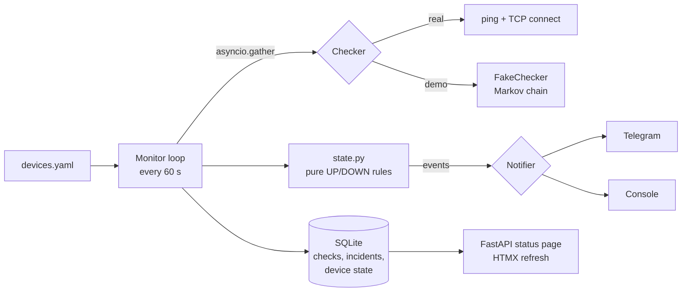
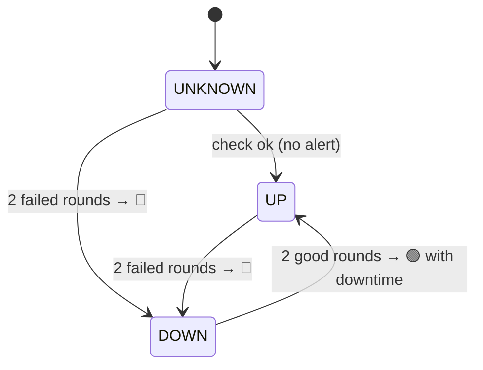

# Uptime Monitor

Watches routers, IP cameras, Wi-Fi access points and printers. Sends a Telegram alert when
one goes down and again when it comes back, with the downtime. A small status page shows the
uptime of every device for the last 24 hours and 7 days.

## Problem

In a hotel, restaurant or small office, a camera or an access point that stops working is
usually noticed days later: when someone needs the recording that isn't there, or when
guests complain about the Wi-Fi. Big monitoring systems (Zabbix, PRTG) are too heavy for a
place without an IT department. This is one process and one YAML file.

## Features

- **`devices.yaml`**: name, IP (or host name), ping on/off, TCP ports to check
  (e.g. 554 for an RTSP camera, 9100 for a printer).
- **Async checks every 60 s**: all devices in parallel (ICMP ping + TCP connect), with a cap
  on concurrency.
- **Telegram alerts** on DOWN (with the reason: "ping: no reply; tcp/554: timed out") and on UP
  (with the downtime: "Downtime: 12 min 30 s (14:02 - 14:14)").
- **No false alarms:** a device is DOWN only after 2 failed rounds in a row and UP only after
  2 good rounds, so one lost ping or a flapping device does not flood the chat.
- **Status page** (FastAPI + HTMX, refreshes every 10 s without reloading): status, uptime %
  for 24 h and 7 days, 24 hourly bars, latency, recent outages. Also `GET /api/status` (JSON).
- **Survives restarts:** device states are stored, so an outage is not announced twice.
- **Demo mode:** 8 simulated devices that fail at random and 7 days of generated history.

## Screenshots


| DOWN alert in Telegram | UP alert in Telegram |
|---|---|
| [screenshot placeholder] | [screenshot placeholder] |

## Architecture



The UP/DOWN decision is a pure function with no I/O, so it is easy to test:



The downtime starts at the **first** failed check and ends at the **first** good check of
the recovery, not at the moments the alerts were sent.

## Quick start (demo, no network setup)

Requires [uv](https://docs.astral.sh/uv/) (it installs Python 3.12 itself).

```bash
cp .env.example .env
uv sync
uv run python -m app
```

Open <http://127.0.0.1:8000>. Demo mode is on in `.env.example`: the page shows 8 fake
devices with a week of history, and every few minutes one of them fails; the alert is
printed in the terminal. With Docker: `cp .env.example .env && docker compose up --build`.

## Monitor a real network

1. Describe your devices in [devices.yaml](devices.yaml) (comments explain every field).
2. In `.env` set `DEMO_MODE=false`.
3. For Telegram alerts: create a bot with [@BotFather](https://t.me/BotFather), add it to a
   group, and set `BOT_TOKEN` and `ALERT_CHAT_ID`. Without them, alerts go to the console.
4. `uv run python -m app` on a machine inside the network (a mini PC or a Raspberry Pi is
   enough), or `docker compose up -d --build`.

## Configuration

See [.env.example](.env.example). The main settings:

| Variable | Default | Meaning |
|---|---|---|
| `DEMO_MODE` | `true` in the example | Simulated devices and history |
| `CHECK_INTERVAL_S` | `60` | Seconds between check rounds |
| `FAIL_AFTER` / `RECOVER_AFTER` | `2` / `2` | Rounds in a row before DOWN / UP |
| `TCP_TIMEOUT_S` | `3` | Keep ≥ 3 on Windows (see BUGFIX.md, bug 3) |
| `RETENTION_DAYS` | `8` | Check results older than this are deleted |

## Design decisions

- **Ping uses the system `ping` command,** not raw ICMP sockets: raw sockets need root or
  admin rights, the command does not. The reply must contain `TTL=` (printed in every
  language) as well as exit code 0, because Windows can exit 0 when a router answers
  "Destination host unreachable".
- **Device addresses are validated** before they reach the command line: no shell is used,
  and an address starting with `-` is refused so it cannot be read as a ping option.
- **Uptime = good checks / all checks** in the window. With a fixed interval that equals
  time-based uptime and is one SQL query. Percentages are rounded **down**, so 99.996 % is
  never shown as 100 %.
- **Hourly bars** come from grouping the stored timestamps by their first 13 characters
  (`2026-10-24T09`): UTC ISO strings sort correctly and group cheaply.
- **One process:** the check loop and the web server share the event loop and the database.
  A failure in one round is logged and the loop continues; a Telegram outage never stops
  the checks.

## Project structure

```
app/
  checks.py     ping and TCP checks, ping output parsing
  state.py      UP/DOWN rules (pure state machine)
  monitor.py    check loop: run, store, decide, alert
  db.py         SQLite: checks, incidents, device state
  uptime.py     uptime % and hourly bars
  web.py        FastAPI routes; templates/ has the HTML
  demo.py       fake devices and 7-day history generator
  devices.py    devices.yaml loading and validation
  messages.py   alert texts
  main.py       starts the loop and the web server
devices.yaml        your devices
devices.demo.yaml   fake devices for demo mode
tests/              pytest suite
```

## Tests and linting

```bash
uv run pytest
uv run ruff check . && uv run ruff format --check .
```

The tests cover the state machine (lost pings, flapping, downtime maths), ping output parsing
with real Russian-Windows, English-Windows and Linux samples, TCP checks against a local
server, the monitor loop (alerts, restarts, Telegram failures, data retention), the demo
history and the web page.

## Bugs found while building

See [BUGFIX.md](BUGFIX.md).

## Next steps

- HTTP checks (status code and response time) for web services.
- A weekly uptime report in Telegram.
- Maintenance windows, so planned reboots do not alert.
